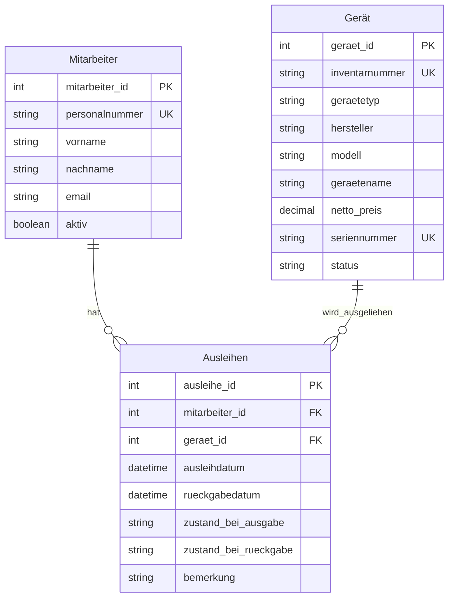

R1 – Höchstens eine aktive Ausleihe pro Gerät
Ein Gerät darf zu einem Zeitpunkt höchstens einer aktiven Ausleihe zugeordnet sein.

R2 – Keine Ausleihe nicht verfügbarer Geräte
Defekte oder ausgemusterte Geräte dürfen nicht neu ausgeliehen werden.

R3 – Nur ausleihberechtigte Mitarbeitende
Neue Ausleihen dürfen nur für aktive Mitarbeitende angelegt werden.

R4 – Plausible Zeitangaben
Das Ausleihdatum muss gesetzt sein. Falls ein Rückgabedatum vorhanden ist, darf es nicht vor dem Ausleihdatum liegen.

R5 – Historie erhalten
Abgeschlossene Ausleihen müssen für die Nachvollziehbarkeit erhalten bleiben. Eine erneute Ausleihe erzeugt einen neuen Datensatz.

R6 – Keine doppelte Inventarnummer
Jedes Gerät muss anhand seiner Inventarnummer eindeutig identifizierbar sein.

R7 – Stammdaten nicht unnötig duplizieren
Geräte- und Mitarbeiterinformationen werden in ihren Stammdatentabellen gepflegt und nicht bei jeder Ausleihe erneut gespeichert. Zustandsangaben, die sich auf einen konkreten Ausleihvorgang beziehen, gehören dagegen in die Ausleihe.